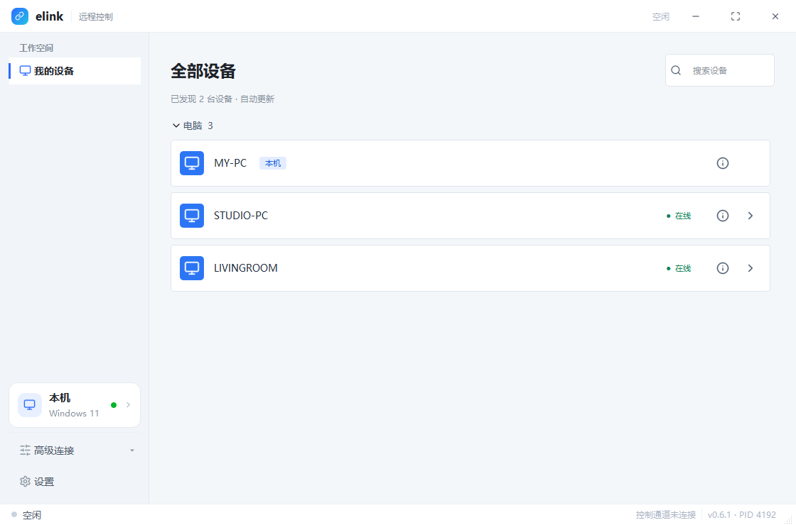
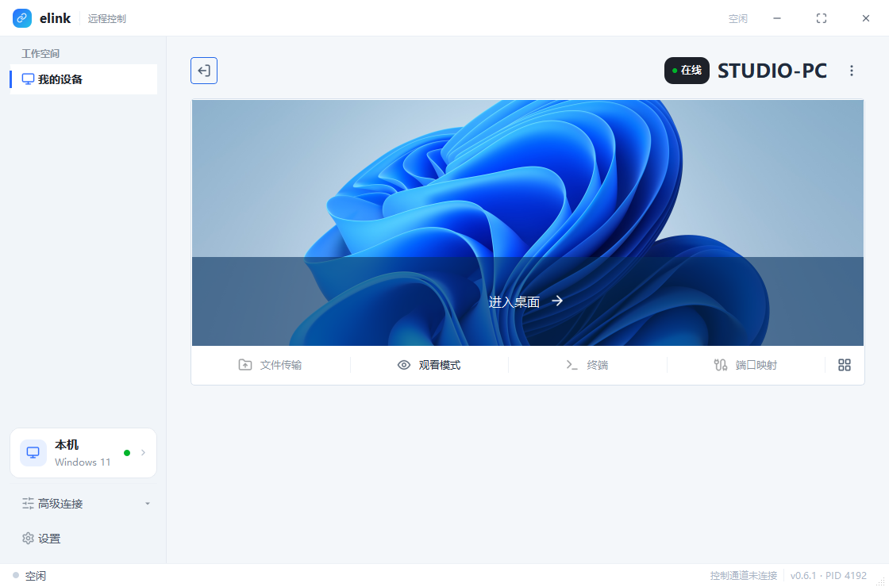
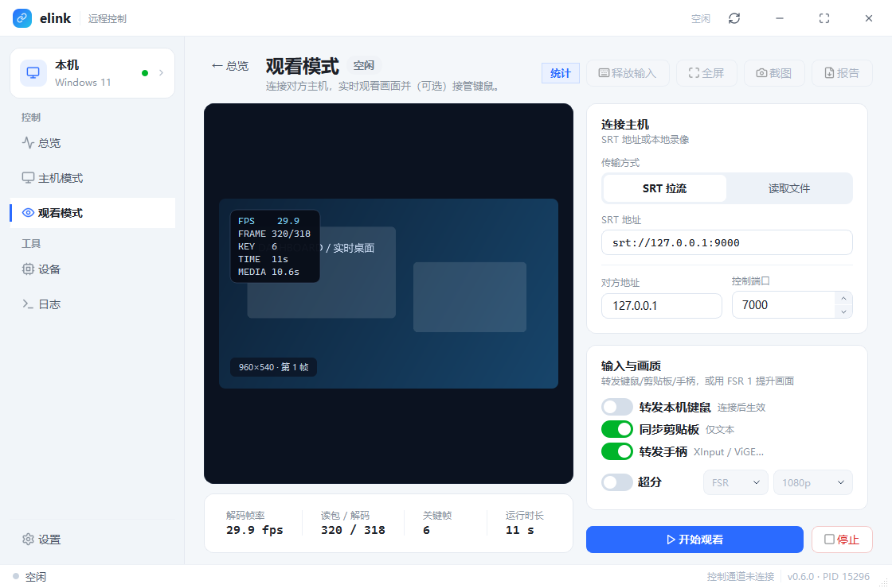
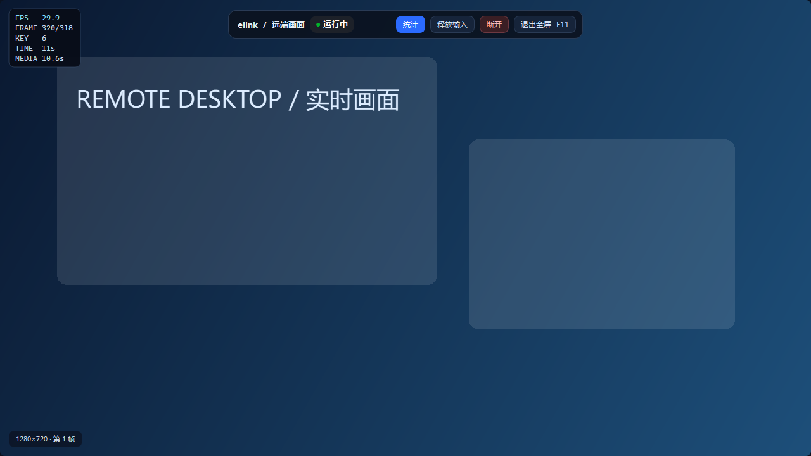
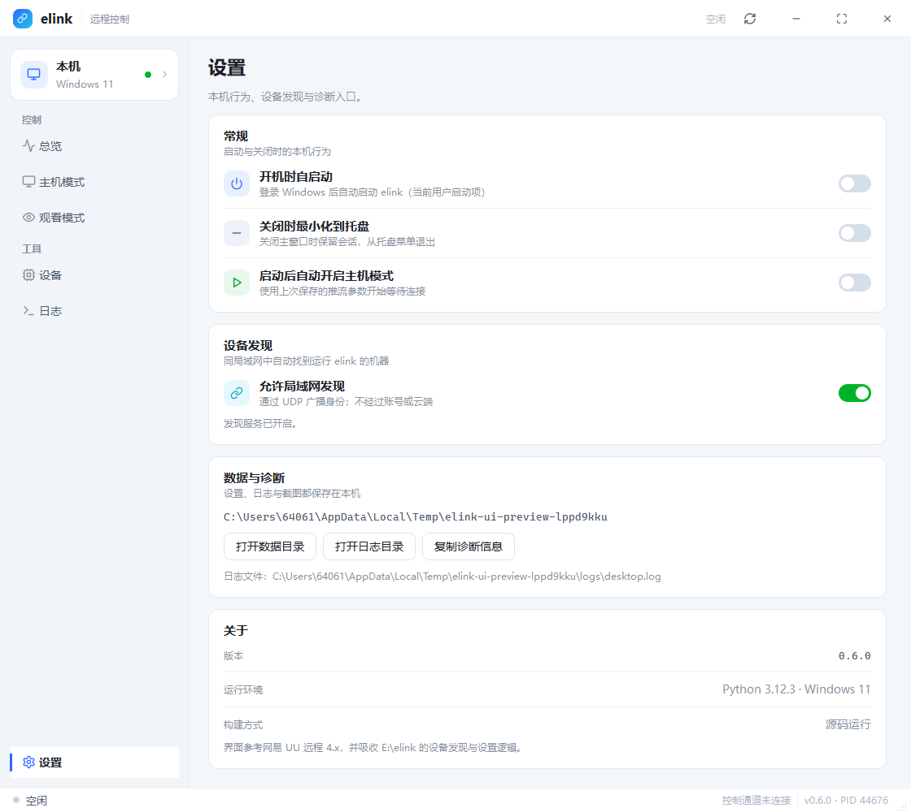
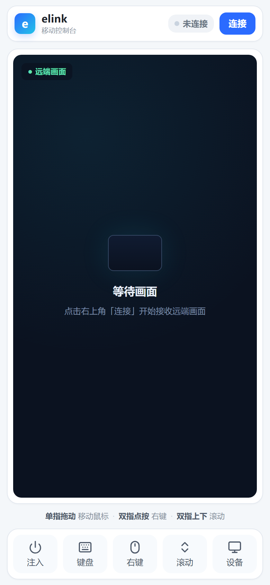

# elink

远程控制与低延迟串流。分层契约与验证记录在本地 `docs/`（默认不进 Git，安装包内仍会附带）。

Windows 免安装 Python 的版本见 [GitHub Releases](https://github.com/yuyuyu501/elink/releases)：
`Elink-<版本>-windows-x64-setup.exe` 或解压后双击的便携 ZIP。发布流程见
[RELEASING.md](RELEASING.md)。

## 当前进度

`backend/` 下 **158 个模块已全部实现，没有空文件**；`frontend/desktop/` 是
PySide6 桌面端，`scripts/` + `packaging/` 提供可验证的打包链路。

| 阶段 | 内容 | 状态 |
| --- | --- | --- |
| A | 采集 -> `Frame` -> `libx264` -> `Packet` -> MPEG-TS 写 `.ts` | 已实测 |
| A | 读 `.ts` -> demux -> `Packet` -> `h264` 解码 -> `Frame` -> 写 PNG | 已实测 |
| B | 同上，把文件换成 `transport/srt.py` 收发 | 已实测 |
| C | 音频链路、协议层、协商、控制通道 | 已单测/自测 |
| D | Qt 桌面端（设备列表/设备详情/远程会话/高级连接/设置）+ 托盘/自启 + 安装包 | 已实测（含冻结产物） |

## 各层实现状态

| 层 | 实现程度 | 说明 |
| --- | --- | --- |
| `media/{frame,packet,stream,timebase}` | 完整 | 数据契约与时间基 |
| `media/container/mpegts` | 完整 | PAT/PMT/PES/PCR/CRC32，单路视频 |
| `media/container/{rtp,rtcp}` | 完整 | RTP 打包（单 NAL / FU-A / STAP-A）、RR 报告 |
| `media/video/codec/*` | 完整 | 18 个编码 / 18 个解码后端，全部基于 ffmpeg 子进程；硬件后端带运行时探测与软件回退 |
| `media/audio/codec/*` | 完整 | AAC(ADTS) / FLAC / Opus，含按码流规则切包与 PTS 推算 |
| `media/audio/filter/*`、`processing/*` | 完整 | 重采样、增益、音量、混音、声道布局、采样格式；NLMS 回声消除、AGC、时域噪声抑制 |
| `media/video/filter/*` | 完整 | 缩放、裁剪、旋转、色彩空间（BT.601/709）、帧率、hwupload/hwdownload |
| `media/sync/*` | 完整 | 系统时钟/流时钟、抖动缓冲、音视频同步 |
| `media/device/*` | 完整 | 多显示器枚举、设备枚举、热插拔轮询、权限检查 |
| `media/video/capture/*` | Windows 完整；Linux X11 完整；Android 需 pyjnius | WGC 无 WinRT 绑定时自动降级为 GDI |
| `media/video/render/*` | 可用 | Windows 走 GDI 窗口上屏，Linux 走 ffmpeg SDL，Android 走 Surface+Canvas；**D3D11/D3D12 交换链未接入** |
| `media/video/hwaccel/*` | 加速层 | D3D11VA/D3D12VA 解码可用；纹理为描述符；零拷贝通路做域/状态校验 |
| `media/video/cursor/*` | Windows 完整 | 指针位图捕获 + alpha 合成 |
| `pipeline/*` | 完整 | 视频（有界队列丢旧帧）、音频（背压不丢帧）、接收 |
| `transport/srt` | 完整 | 借 ffmpeg libsrt 搬字节（`-c copy`） |
| `transport/webrtc/*` | 协商层完整 | ICE 适配、轨道、DataChannel、PeerConnection（SRTP 加解密依赖底层栈） |
| `signaling/*` | 完整 | SDP 构造/解析（唯一允许拼 SDP 处）、消息编解码、TCP 客户端/服务端 |
| `control_channel/*` | 完整 | TCP / WebSocket（RFC 6455 子集）/ DataChannel，统一协议帧 |
| `input_capture/*`、`input_injection/*` | Windows 完整；Linux 完整；Android 需 pyjnius | 低级钩子 / SendInput；evdev / uinput / XTest；getevent / InputManager |
| `nat/*` | 完整 | STUN（Binding + XOR-MAPPED + MESSAGE-INTEGRITY）、TURN（Allocate/Refresh/Permission）、ICE 候选与连通性检查 |
| `qos/*` | 完整 | 码率分配、AIMD 拥塞控制、分组 XOR FEC、质量分级 |
| `security/*` | 完整 | HMAC 令牌、TLS 上下文与指纹、DTLS-SRTP 密钥派生（RFC 5764）、E2EE（需 `cryptography`） |
| `session/*` | 完整 | 状态机、指数退避重连、能力协商与编码器回退 |
| `metrics/*`、`event/*`、`logging/*`、`errors/*`、`config/*`、`registry/*` | 完整 | 基础设施 |

## 依赖

- Python 3.11+（后端只用标准库，`main.py` 的命令行链路**不需要** `pip install`）
- **桌面端界面**：`PySide6 >= 6.7`（`pip install -e .` 会一并装上）
- **打包**：`pyinstaller >= 6.10`（`pip install -e ".[dev]"`），Windows 安装包另需 Inno Setup 6
- **ffmpeg 在 PATH 中**，需要 `libx264` 编码器与 `libsrt`（SRT 阶段用）
  - `ffmpeg -hide_banner -encoders | findstr libx264`
  - `ffmpeg -hide_banner -protocols | findstr srt`
- 可选：`cryptography`（E2EE）、`pyjnius`（Android 采集/注入/渲染）

ffmpeg 只承担「算法」与「SRT 收发」：编码/解码走 rawvideo 管道，封解封装与
时间戳全部由本项目实现，因此 `Frame`/`Packet`/`Timebase` 契约是真的在被验证。

## 运行

桌面端（图形界面）：

```powershell
python main.py --ui
```

命令行链路见下（不需要 Qt）。

本地闭环（采集 -> 编码 -> `.ts` -> 解码 -> PNG）：

```powershell
py -3.13 main.py --mode loopback --duration 3 --width 640 --height 360 `
    --out out/demo.ts --frames-dir out/frames
```

发送端（SRT caller）：

```powershell
py -3.13 main.py --mode send --srt-url srt://127.0.0.1:9000 `
    --duration 8 --width 640 --height 360
```

接收端（SRT listener，先启动）：

```powershell
py -3.13 main.py --mode receive --srt-url srt://127.0.0.1:9000 --frames-dir out/frames
```

只解本地文件：

```powershell
py -3.13 main.py --mode receive --out out/demo.ts --frames-dir out/frames
```

回归测试（不需要 pytest）：

```powershell
py -3.13 tests/test_mpegts_roundtrip.py    # 编码/封装/解封装/解码契约
py -3.13 tests/test_protocols.py           # RTP / FEC / 抖动缓冲 / SDP / 控制帧
py -3.13 tests/test_audio_and_session.py   # 音频链路 / 控制通道 / 会话协商
```

## 桌面端（Qt）

`frontend/desktop/` 是 PySide6 界面：无边框标题栏 + 我的设备 / 高级连接 / 设置侧栏，
启动后显示自动更新的设备列表；点设备打开详情，再选择「进入桌面」或「观看模式」。
详情左上角返回列表，右上角显示设备身份与信息菜单。视觉参考网易 UU 远程 4.x 桌面端的
界面语言（冷白底、白色圆角卡片、亮蓝主色、状态胶囊、预览上方操作条），默认窗口
1120×740、字号整体 +1px；同时吸收了 `E:\elink` 的自动发现、托盘/自启动、
错误提示条与 F8/F10 交互。完整设计说明随安装包的 `docs/` 目录提供；下面给出主要页面截图。

| 全部设备（示例数据） | 设备详情（示例数据） |
| --- | --- |
|  |  |

| 观看模式 · F10 统计（示例画面） | 设备与发现（示例数据） |
| --- | --- |
|  |  |

| 独立全屏播放器 | 设置（示例数据） |
| --- | --- |
|  |  |

```powershell
pip install -e .            # 安装 PySide6 依赖（或 pip install PySide6）
python main.py --ui         # 启动桌面端
```

- **主机**：采集 → 编码（libx264 / NVENC / QSV / AMF）→ MPEG-TS → SRT/文件，
  并监听 TCP 控制通道接受远端键鼠、文本剪贴板和手柄。
- **观看**：SRT/文件 → 解封装 → 解码 → 预览；可转发本机键鼠、剪贴板和 XInput 手柄；
  F8 释放输入、F10 叠加连接统计、F11 打开独立全屏播放器、Ctrl+Alt+Shift+Q 断开。
- **全屏播放器**：独立全屏窗口，顶部悬浮控制栏（统计 / 释放输入 / 断开 / 退出），
  鼠标静止后自动隐藏；Esc/F11 退出。
- **超分辨率**：观看页「超分」开关 + FSR 1 / RTX VSR 引擎 + 1080p/1440p/4K 输出。
  FSR 1 用 AMD FidelityFX EASU + RCAS（OpenGL 4.2 离屏渲染）；RTX VSR 走
  `elink_video.dll` 的 D3D11 视频处理器，仅 NVIDIA RTX + 新驱动可用，失败时自动回退 FSR 1。
- **性能报告**：主机/观看页可导出 JSON，含编码、解码、渲染的 P50/P95/P99 耗时。
- **我的设备**：枚举有效网卡，通过 UDP 49320 向支持广播的接口逐一发送发现消息。
  同一设备的多个地址合并显示，支持名称/IP 搜索、电脑分组折叠与设备信息。
  点设备行只打开详情；「进入桌面」开启键鼠控制，「观看模式」关闭键鼠、剪贴板和手柄转发。
  设备离线或未开放串流时禁用连接。详情封面是默认壁纸，文件传输、终端和端口映射暂未开放。
  当前协议只交换身份与端口，对方仍需从「高级连接 → 主机配置」开放 SRT 串流，
  尚不支持远程按需启动采集；手动连接与原有运行总览也保留在高级连接中。
- **设置**：开机自启、关闭到托盘、启动后自动开启主机、设备发现与同步开关、
  数据/日志目录与诊断信息复制。
- 界面不直接碰 ffmpeg/socket/Win32：全部经 `frontend/desktop/service.py` 在后台
  线程执行，用 Qt 信号回传帧与统计；设备枚举也改为后台线程，不再阻塞启动。
- 数据目录 `%LOCALAPPDATA%\Elink`（可用 `ELINK_DATA_DIR` 覆盖）；
  与旧版合并安装时沿用同一用户目录，但设置文件名是 `config/desktop.json`，
  不会覆盖旧版的 `desktop-v3.json`。

界面截图可以在不弹出窗口的情况下重新生成：

```powershell
python -m scripts.ui_preview --platform windows --out out/ui-preview
python -m scripts.ui_preview --platform windows --demo-peers --pages devices --out out/ui-preview
```

## 移动端（PWA）

```powershell
py -3.13 frontend/dev_server.py --port 8099     # 只预览
py -3.13 frontend/dev_server.py --port 8099 --allow-inject
# 手机浏览器打开 http://<本机IP>:8099/mobile/
```

移动端与桌面端共用同一套设计令牌（冷白底、白色圆角卡片、亮蓝主色、深色预览、
黑底在线胶囊），保留了原手势：单指拖动控制鼠标、双指点按右键、双指上下滚动、
「键盘」按钮按文本注入。画面是低频快照（默认 2fps / 480 宽），不是视频流。



## 打包

```powershell
# 构建 + 产物自检 + 便携 ZIP（+ 若已安装 Inno Setup，则再出安装包）
py -3.13 -m scripts.package_windows

# 只构建
py -3.13 -m scripts.build
```

产物：

- `dist/Elink/Elink.exe` —— 当前 onedir 目录版（启动快、升级只换变化文件）；
  双击（无参数）默认打开图形界面
- `dist/<版本>/Elink-<版本>-windows-x64.zip` —— 便携包
- `dist/<版本>/Elink-<版本>-windows-x64-setup.exe` —— 离线安装包（Inno Setup 6；
  安装到 `%LOCALAPPDATA%\Programs\Elink`，开始菜单/可卸载，沿用旧版 AppId）
- `dist/<版本>/SHA256SUMS.txt`、`dist/<版本>/verification.json` —— 发布校验
- `dist/<版本>/package-summary.json` —— 该版本构建摘要

多个版本会并存于 `dist/<版本>/`，根目录只保留一个 `dist/`。

安装包需要 Inno Setup 6 的 `ISCC.exe`：可设 `ELINK_ISCC` 指向已有工具链，
或安装到默认 `Program Files`。完整发布流程见 [RELEASING.md](RELEASING.md)
（`docs/` 默认不进 Git），Release 正文在 [releases/v0.6.1.md](releases/v0.6.1.md)。

> **onedir 不能只拷 exe**：`Elink.exe` 依赖同目录的 `_internal/`、`docs/`、
> `web/` 等文件。便携 ZIP 解压后请保留整个 `Elink/` 目录，或者用安装包；
> 单独把 `Elink.exe` 拖到桌面会因为找不到依赖而无法启动。

> **后端在哪里**：PyInstaller 把 Python 模块压进 `Elink.exe` 内部的 `PYZ.pyz`，
> 所以磁盘上不会出现独立的 `backend/` 目录，但 backend 确实在 exe 里（本次包内有
> 222 个 backend 模块）；`_internal/` 放的是 Python 运行时、Qt DLL 与图标等资源。
> 后端不是独立服务，它和界面在同一个进程里，用后台线程跑采集/编码/SRT/控制通道。
> 唯一没有打包进 exe 的运行时依赖是 **ffmpeg**，需要目标机器 PATH 中可用。

**打包必须验证产物本身**：`scripts/package_windows.py` 会用打好的 exe 跑
`--self-test`，检查 Qt 平台插件、图标资源、字体、ffmpeg 通路
（编码 → 封装 → 解封装 → 解码），任一项失败就中止，不会产出「装完打不开」的包。

Linux：

```bash
python -m scripts.package_linux      # PyInstaller 目录 + tar.gz + elink.desktop
```

> 打 exe 时的关键点：注册表按「模块路径字符串」动态导入后端，PyInstaller 的静态
> 分析看不到，必须 `--collect-submodules backend`；而该选项依赖常规包，所以
> `backend/`、`frontend/` 下每个目录都有 `__init__.py`（早期用命名空间包时打包
> 出来的程序「注册表为空」，就是踩了这个坑）。

## 已知限制

- **采集**：Windows 为 GDI `BitBlt`（DXGI 桌面复制零拷贝通道未接入）；Wayland 需要
  PipeWire portal，当前会给出明确错误而不是静默失败。
- **渲染**：D3D11/D3D12 的交换链未接入，目前是 CPU 上屏；接口与之保持一致。
- **时间戳**：解码器按「第 N 个输出帧对应第 N 个输入包」映射 PTS，要求码流无 B 帧
  重排序（编码端固定 `-bf 0`）。
- **SRT**：借 ffmpeg 的 libsrt 搬字节（`-c copy`），本项目不做 SRT 协议实现；
  连接建立时前 1~3 帧会因探测窗口被丢弃（实测 5 秒 150 帧收到 149 帧）。
- **SRTP/E2EE**：密钥派生已实现，实际加解密需要 `cryptography` 或底层 WebRTC 栈。
- **MPEG-TS**：当前只封装单路视频；音频进 TS 需要扩展 muxer 的 stream_type 表。
- **Android**：采集/注入/渲染通过 pyjnius，需要真实 Android 运行环境与系统权限。
- **手柄**：只实现 ViGEmBus 兼容模式，需要目标机器自行安装 ViGEmBus 驱动；
  `E:\elink` 的 ElinkPad 自研驱动没有搬入，安装包也不会替用户安装驱动。
- **剪贴板**：只同步 Unicode 文本（最多 64000 字符），不同步图片/文件；
  当前实现是 Windows 原生 API，非 Windows 平台不可用。
- **超分**：FSR 1 与 RTX VSR 都会回读 CPU 再交给 QImage 预览，不是零拷贝上屏；
  RTX VSR 需要 NVIDIA RTX 显卡和较新驱动，其它 GPU 自动回退 FSR 1。
  每帧增加一次 GPU 处理 + 回读，4K 输出下帧率可能低于 30fps。
- **性能报告**：统计本机编码/解码/渲染阶段耗时，不包含网络 RTT 或端到端延迟。
- **发现服务**：无鉴权 UDP 广播，仅适合个人局域网；需防火墙放行 UDP 49320。
- **安装包签名**：当前未代码签名，SmartScreen 可能提示；GitHub Releases 工作流已准备，
  实际替换仓库/推送 Tag 还需要仓库凭据。
