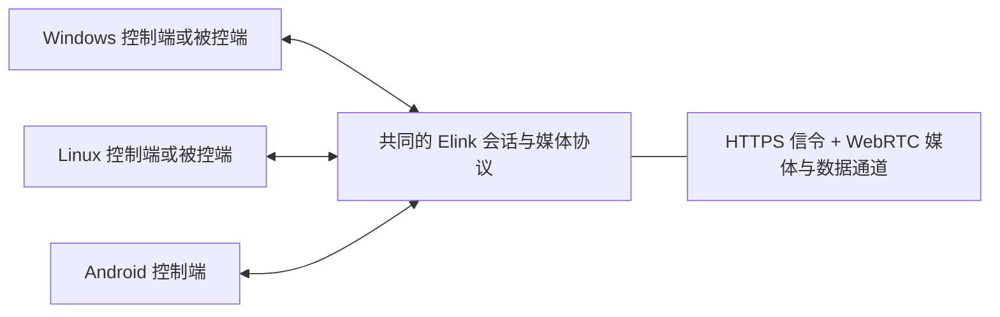

# Elink Linux 与 Android 设计与实现记录

日期：2026-10-21。状态：0.5.0 预览实现与验证中。后文保留验收目标，不能把目标当成已完成；实际证据与限制以本节和版本说明为准。

已实现平台后端隔离、Linux X11 双角色、原生 Kotlin Android 控制端工程和 H.264 基线/High profile 协商。Linux 目标环境实际为 Deepin 25/X11/glibc 2.38、RTX 2080 Ti；缺少 NVIDIA 编解码运行库，测试使用软件编解码。Windows 主机发往 Linux 的稳定 720p60 段达到 60 FPS；反向软件编码约 54–56 FPS。双向音视频、Qt 桌面会话、CPU/OpenGL 像素和 X11 输入检查通过。修复了 Qt 中文区域设置使 PyAV 音频线程退出的问题。未安装驱动。

Android 已通过 Gradle 单元测试与 APK 构建。按用户选择，停止 USB 调试，APK 发布后由用户实机验收。尚未验证 MediaCodec、实体输入、热稳定性或 Android/桌面实际互通。Wayland 代码仅实验性源码路径，冻结 Linux 包的正式预览范围是 X11；uinput 权限、手柄反馈、剪贴板和硬件编解码仍需单独验收。

## 1. 范围与交付目标

用户已确认 Linux 的控制端和被控端同一阶段交付。Android 先按手机、平板作为控制端设计；Android 被控端不属于本轮范围。继续面向个人使用、低延迟游戏串流、键鼠与手柄，不考虑 macOS/iOS。

| 平台 | 控制其他电脑 | 被其他设备控制 | 首轮范围 |
| --- | --- | --- | --- |
| Windows | 保留 | 保留 | 与新平台互通，现有功能回归 |
| Linux x86_64 | 实现 | 实现 | 桌面登录会话中的双角色，Wayland 与 X11 分别验收 |
| Android arm64 | 实现 | 暂不实现 | 骁龙 870 手机、骁龙 7s Gen 2 平板 |

Linux 首轮锁定 Deepin 25/X11/glibc 2.38；GNOME/KDE Wayland、旧版 glibc 与其他驱动组合是后续验收范围。不把一个组合通过称为所有 Linux 桌面均已支持。

保留当前连接方式：局域网、可达地址及外部 Tailscale。没有新增自有服务器的前提。跨网发现与打洞继续依赖已有网络路径，设备装有 Elink 不代表一定可以互相连接。

平台代码位于 `elink/platforms/{windows,linux}`，共享输入状态与校验位于 `elink/core/input_session.py`，Windows 原生源码位于 `native/windows`，Android 工程位于 `android`。旧 Python 导入路径保留兼容别名，协议规范位于 `protocol`。

## 2. 架构决策

采用共同协议、平台后端与各端原生媒体路径。Windows/Linux 的桌面管理界面继续使用 Python + Qt；Android 使用 Kotlin 原生 Views，将视频显示交给独立的 SurfaceViewRenderer，首轮没有引入 Compose。

不以全项目重写为跨平台前提。首先识别现有公共逻辑与 Windows 专用依赖，再按小步迁移抽出平台边界；每一步保持 Windows 可运行。Linux 需要的 PipeWire/libei/硬件表面互操作按需使用 C/C++ 辅助模块。



| 边界 | 共享目标 | 平台适配 |
| --- | --- | --- |
| 发现与会话 | 设备身份、地址合并、占用状态、结束与超时规则 | 桌面网络接口、Android NSD、地址缓存 |
| 媒体 | H.264/Opus 协商、流设置与统计口径 | 采集、编解码、音频设备、GPU 呈现 |
| 输入 | 按下/释放、绝对与相对移动、手柄和光标状态 | Windows 注入、Linux Portal/X11/uinput、Android 输入采集 |
| 生命周期 | 清理顺序、释放全部输入、断线恢复 | 休眠、窗口失焦、Activity/Surface 销毁 |
| 设置与身份 | 字段语义、能力协商、证书校验规则 | Windows DPAPI；Linux 0700 目录与 0600 PEM；Android 应用私有证书指纹缓存 |
| 更新与安装 | 版本比较、下载校验、更新提示 | Windows 安装器、Linux 软件包、Android 签名 APK |

Android 使用原生 libwebrtc，Linux 首轮继续使用现有 aiortc 路线。两者共享的是标准协议及应用消息规范，不是同一个运行时库。必须实测 aiortc 与 libwebrtc 的 SDP、RTP/RTCP、DataChannel、拥塞反馈和会话清理互通。

## 3. 共同协议与兼容性

### 媒体协商

- 首轮继续使用 H.264 视频和 Opus 音频，不同时引入新的传输协议或新视频编码格式。
- 交换实际支持的编码 profile/level、分辨率、帧率和显示能力。不能把 Windows 的 H.264 Level 5.2 或所有分辨率/帧率档位直接写死到安卓端。
- 用户设置是请求值；两端协商实际可用组合。不支持的设置禁用或明确提示，不静默用低档位冒充成功。
- 分辨率、帧率继续只控制串流，不修改被控系统的分辨率、刷新率或 DPI。
- 保留优先维持用户目标的码率策略，同时控制发送排队和真实拥塞。静态画面低有效码率不独立触发降档，也不发送无意义填充流量。
- 记录采样尺寸、编码尺寸、输出尺寸、色彩矩阵与范围，覆盖原生及 50%/66.7% 采样路径，避免再次出现不同解码器画质明显不一致。

### 输入与光标

- 在现有协议审计后设计可协商的跨平台输入扩展。物理按键以 USB HID usage 等平台中立表示为目标，Windows VK、Linux evdev、Android KeyEvent 在边界转换；与旧 Windows 对端保留已验证的兼容路径。
- 文本输入与物理按键分别处理，覆盖中文输入、左右修饰键、方向键、小键盘、NumLock、键盘布局及焦点切换。
- 可见指针使用实际视频区域的坐标映射；游戏相对移动发送相对位移，保留小数累计，灵敏度 0 不额外叠加远端桌面加速。不同系统对原始鼠标计数的暴露不同，需要各端实测。
- 光标图像、热点、可见性与位置作为独立能力协商。采集端已嵌入光标时，不再叠加第二个；无法移除视频内光标时，不能开放会产生双光标的模式。
- 按键释放、模式切换、会话结束走可靠通路；鼠标/手柄快照保留序号与会话隔离。失焦、后台、断线和重连统一释放输入。
- 每台被控电脑最多一个控制会话。连接成功、媒体可播放与输入可注入是不同状态，必须分别报告。

### 能力发现

建议新增可选能力描述，覆盖控制/被控角色、实际媒体后端、输入后端、光标模式、剪贴板、可用画质组合及权限状态。字段名称和版本号在审计现有协议后确定。

旧 Windows 对端没有能力字段时使用明确的兼容默认值。收到未知可选字段可以忽略；不认识的关键能力不能默认可用。状态栏继续显示实际编码器、解码器、FPS、接收 Mbps、网络 RTT 和阶段耗时，统计定义跨端一致。

## 4. Linux 双角色设计

### 控制端

复用桌面端设备列表、设置、单层串流标题栏及控制中心的交互。控制中心点击外部关闭、光标跨窗口返回、失焦释放和错误关闭行为作为平台回归项。

媒体路径目标为 H.264 接收 -> 硬件解码表面 -> GPU 颜色转换/缩放 -> 窗口呈现。首轮优先验证用户现有 NVIDIA 显卡；VA-API 等其他后端通过实际能力检测开放，不预先承诺兼容。

保留软件解码/CPU 显示回退，并明确记录实际后端及回退原因。Linux 上 DMA-BUF、EGL、CUDA 与 Qt 的互操作取决于驱动和缓冲格式，不能把使用硬解或 OpenGL 等同于全链路零拷贝。是否减少 CPU 回读必须通过复制次数和阶段测量确认。

### Wayland 被控端

采集以 XDG ScreenCast/RemoteDesktop Portal + PipeWire 为主。需要输入与采集时使用配套远程桌面会话，避免建立两个互不关联的权限会话。[1][2]

输入优先使用 RemoteDesktop Portal 提供的 EIS 连接和 libei；后端不支持时，评估其提供的 Notify 接口。建立 EIS 连接后不能混用 Notify 输入接口。[2][3]

Portal 可能要求用户选择屏幕并授权输入。运行时检测版本、实际权限及恢复令牌支持；令牌有效时按系统规则恢复，失效则重新提示。普通应用不能保证绕过系统确认，也不把应用已经启动等同于后台随时可控。首轮不承诺锁屏、登录界面或无桌面会话控制。

优先协商 PipeWire 的独立光标元数据，保留 embedded/hidden 模式能力检测。根据视频实际区域、屏幕位置、桌面分数缩放和光标热点建立统一映射；显示器变化、休眠恢复及 Portal 关闭后重建资源。[1]

### X11 被控端

单独实现 X11 采集和输入后端，使用可用的 X11 采集接口及 XTest 等输入能力。X11 桌面控制成功不能替代 Wayland 验收，也不能独立证明所有游戏的原始输入兼容。

### 音频、编码与手柄

系统声音从 PipeWire/PulseAudio 的可用输出监视源采集，首轮只包含系统播放声音；设备切换、静音、拔插和音画同步分别测试。

H.264 编码优先 NVIDIA NVENC，失败时可回退 libx264，但需要显示实际后端。软件回退不能作为高帧率性能通过的证据。采集帧与编码提交均使用有界队列，分别统计重复帧、过期帧和有效更新。

Linux 控制端通过成熟的 SDL/Linux 输入接口读取实体手柄。Linux 被控端使用内核已有 uinput 虚拟输入机制，验证按键、轴、扳机、震动和热插拔；不需要移植 Windows ElinkPad 驱动。

uinput 需要系统权限配置，应给出明确的用户安装步骤或受限助手方案；不要求整个应用以 root 运行。首轮开发测试不自动修改设备权限或安装驱动。

### 常规功能

配置与日志使用 XDG 目录。开机自启使用当前用户的桌面自启动机制；系统托盘缺失时正常显示或退出，不让应用进入无法找回的隐藏状态。

文本剪贴板按桌面实际接口实现。Wayland 需要检查远程桌面剪贴板等可用能力；不支持时给出手动发送文本入口。不能把 X11 的剪贴板处理直接当成 Wayland 的全局剪贴板能力。

## 5. Android 控制端设计

### 技术路线

界面采用 Kotlin 原生 Views，视频区域直接使用原生 SurfaceViewRenderer。连接、设备、设置和控制中心使用移动端控件；不同屏幕尺寸与横竖屏仍需实机验收。

推荐首轮使用 libwebrtc 的硬件解码工厂与共享 EGL 上下文，路径为：

```text
WebRTC 接收 -> MediaCodec 硬解 -> SurfaceTexture/GPU 纹理
            -> EGL 渲染 -> SurfaceViewRenderer -> 系统合成与显示
```

这条路线避免应用层逐帧转 Bitmap/RGB 后交给界面重绘。它仍包含解码输出、纹理处理与系统合成，不能称为没有复制或没有延迟。[4]

MediaCodec 的低延迟参数从 API 30 起可用，但是否支持、libwebrtc 的解码器是否实际传入该参数都需要核验。必要时使用受控的解码器工厂适配；设置请求成功不代表性能已经改善。[5]

建议最低 Android 11/API 30、首发 arm64-v8a；以两台设备的实际系统版本确认后锁定。目标 SDK、NDK、libwebrtc 提交和构建工具在实施时固定。WebRTC AAR 使用可复现且许可证完整的构建产物，避免不明来源的预编译包。[9]

音频先沿用 WebRTC 的 Opus/Android 音频输出集成，不同时另写音频引擎。实际延迟需区分扬声器、有线和蓝牙输出。

### 操作体验

首页为设备列表，点击连接；串流默认横屏，按比例适配内容，画面之外的黑边不产生远端点击。控制中心以覆盖层显示，不长期占用视频高度。

支持触控板模式、直接点按模式、软键盘及常用组合键入口。虚拟手柄先采用固定的可用布局，实体手柄覆盖摇杆、扳机、按键和设备拔插，震动按设备能力开放。

外接鼠标在可见光标时使用绝对定位；游戏相对输入使用 Android pointer capture，仅在有效焦点和用户进入控制后获取，打开控制中心、失焦及退后台立即释放。[6]

桌面鼠标三种模式的能力需要协商。触屏模式不显示无意义的本机箭头；屏幕旋转、系统缩放、视频黑边和动态分辨率切换后重新计算坐标。

Activity/Surface 生命周期与会话分开管理：旋转或重建不能留下不可见的输入捕获；Surface 失效时停止向旧 Surface 提交并重建呈现，退出或后台按既定策略释放远端输入。网络切换后清理旧会话再重连，避免被控端长期显示“控制中”。

### 网络与设备列表

Android 不依赖桌面版 Tailscale CLI，也不为获取设备列表向用户索取 tailnet 管理 API 密钥。

局域网可使用 Android NSD/mDNS，但现有桌面发现协议是否与之匹配需要实施时检查；必要时保留现有发现机制并增加明确的兼容服务公告。mDNS 不保证跨 Tailscale 网段传播。

跨 Tailscale 首轮支持输入一次对端 IP/MagicDNS 名称、保存设备、后续探测并点击连接。完整 tailnet 自动枚举列为后续独立能力，不将其作为 Android 可连接的前提。应用不自行启动第二个 VPN 与 Tailscale 争用系统 VPN 通道。

### 平台功能边界

Android 剪贴板优先提供前台会话中的显式发送/接收。系统限制后台读取剪贴板，不能承诺与 Windows 相同的任意时刻后台双向同步。[7]

Android 不提供 NVIDIA RTX VSR。首轮默认原生分辨率及 GPU 缩放；FSR 1 移植作为独立的可选验证项，测清晰度、功耗与持续帧率后再开放。暂不加入 Transformer 超分或时域超分，以免同时引入新的性能变量。

骁龙 870 和 7s Gen 2 分别枚举 H.264 硬解能力与屏幕刷新率，测试 720p/1080p 的 60/90/120 FPS 可用组合，1440p 作为扩展。90/120 FPS 仅在硬解、屏幕和实测均支持时开放；不能由 SoC 型号直接保证高档位。

## 6. 安装、更新与项目组织

同一仓库维护公共协议规范、Linux 桌面适配和 Android Gradle 工程。发行文件分别为 Windows ZIP/Setup.exe、Linux x64 .deb、Android arm64 APK。

Linux 首先为选定发行版提供完整 .deb，验证依赖和用户会话集成；AppImage 后续再做。包内不携带或自动安装 NVIDIA 驱动，不声称一个包可以覆盖所有 glibc/桌面环境。

Android 提供已签名的完整 APK，可放入 GitHub Releases，无需自建下载服务器。持续更新需要稳定的应用 ID 与签名身份，签名密钥单独备份且不得入库。普通应用的覆盖安装仍需 Android 系统安装界面确认，不能照搬 Windows 的文件替换更新方式。[8]

更新资产按平台与架构明确选择，防止 Linux/Android 更新器误下载 Windows ZIP。Windows 的 Setup.exe 命名与既有更新入口保持兼容。

增加 Linux CI、Android 构建和协议互通测试；这些通过不代表 Portal、硬解、真实触控或物理手柄验收通过。Android 模拟器及 Linux 虚拟机只验证基础行为，不代替目标 GPU/设备测试。

## 7. 实施里程碑

| 阶段 | 工作与产物 | 完成条件 |
| --- | --- | --- |
| D0 环境与协议基线 | 确定 Linux 发行版/桌面、Android 版本；审计平台依赖与现有协议；形成兼容样本、能力表及错误码 | 现有 Windows 行为有可重放基线；跨平台消息及版本回退规则明确 |
| D1 双端原型 | Linux 控制和被控原型同时推进；Android 实现原生接收原型；验证 Portal、输入和硬解可用性 | Windows -> Linux、Linux -> Windows、Android -> Windows 均有真实音视频和基础输入；失败可定位 |
| D2 功能闭环 | Linux 双角色与 Android 控制端接入设备页、控制中心、键鼠/触控、手柄、退出与重连 | Android -> Linux 及 Linux -> Linux 通过；Wayland/X11 分开记录；断线无残留按键或会话占用 |
| D3 画质与性能 | 完成硬件路径、尺寸/色彩一致性、高帧率矩阵和持续运行测试 | 在目标硬件上达到约定档位，报告有效更新、P95/P99、功耗与热降频；回退行为明确 |
| D4 平台预览包 | Linux 安装/卸载/升级与 Android APK 签名更新；跨端回归 | 包可安装且可更新，版本选择正确；随后由用户执行真实游戏验收 |

Linux 控制端和被控端从 D1 起同时实现，不能只完成控制端就将 Linux 支持标为交付。里程碑表示验证依赖，不表示拆成两个独立软件或承诺具体工期。

## 8. 验收矩阵

- 角色：Windows -> Linux、Linux -> Windows、Linux -> Linux、Android -> Windows、Android -> Linux；Windows -> Windows 做回归。
- Linux：选定的 GNOME/KDE Wayland 分别测试，X11 单独测试；显示缩放含 100%/150%，覆盖权限拒绝与令牌失效。
- Android：两台实体设备，触控、外接鼠标/键盘、实体/虚拟手柄；覆盖旋转、退后台、Surface 重建、网络切换和长时间游戏。
- 画质：原生/66.7%/50%，720p/1080p 及硬件可用的高档位；小字、彩色文字、灰阶、棋盘格、滚动和快速运动分别比较。记录实际编码器、解码器、颜色范围及各级尺寸。
- 帧率：区分发送帧、解码帧、呈现帧和内容真实更新率，不用重复呈现同一帧的数字证明源画面达到目标帧率。
- 性能：先建立 1080p60 的可比较基线，再测试支持的 90/120 FPS 和更高分辨率；记录帧间隔、队列等待、丢帧和各阶段 P50/P95/P99。目标参数可选不等于性能达标。
- 网络：局域网、Tailscale 直连、中继、突发丢包、带宽下降及恢复；不把公网测速或 DSCP 标记当成专用带宽保证。
- 生命周期：控制端强退、被控端强退、休眠、输入权限撤回、更新退出及重复连接；确认输入释放与会话占用恢复。
- 端到端延迟：使用同一时钟或高速摄影测输入到画面反应；跨设备单调时钟差值、RTT 加解码耗时均不作为端到端延迟。

## 9. 资料依据与待验证项

本轮核对了以下官方接口文档。接口存在不代表指定发行版、驱动或 Android 设备已经实现全部能力。

1. [XDG ScreenCast Portal](https://flatpak.github.io/xdg-desktop-portal/docs/doc-org.freedesktop.portal.ScreenCast.html)：PipeWire 流、光标模式、恢复令牌与接口版本差异。
2. [XDG RemoteDesktop Portal](https://flatpak.github.io/xdg-desktop-portal/docs/doc-org.freedesktop.portal.RemoteDesktop.html)：远程输入、权限恢复、EIS 与 Notify 接口的互斥使用。
3. [libei 官方说明](https://libinput.pages.freedesktop.org/libei/)：Wayland 输入模拟与 EIS 实现。
4. [Android MediaCodec](https://developer.android.google.cn/reference/android/media/MediaCodec)：输出 Surface、缓冲与呈现生命周期。
5. [MediaFormat.KEY_LOW_LATENCY](https://developer.android.google.cn/reference/android/media/MediaFormat#KEY_LOW_LATENCY)：API 30 起的可选低延迟解码参数。
6. [Android pointer capture](https://developer.android.google.cn/develop/ui/views/touch-and-input/gestures/movement#pointer-capture)：API 26 起的相对鼠标捕获及焦点条件。
7. [Android 10 剪贴板限制](https://developer.android.google.cn/about/versions/10/privacy/changes#clipboard-data)：非输入法、非当前焦点应用不能读取剪贴板。
8. [Android 应用签名](https://developer.android.google.cn/studio/publish/app-signing)：应用更新的签名身份与密钥管理。
9. [WebRTC Android 开发入口](https://webrtc.github.io/webrtc-org/native-code/android/)：原生 Android 构建与 SDK；该入口含历史构建说明，具体依赖和命令必须以实施时锁定的源码提交重新核对。

工程对照继续参考 [Moonlight Qt](https://github.com/moonlight-stream/moonlight-qt)、[Moonlight Android](https://github.com/moonlight-stream/moonlight-android) 和 [Sunshine](https://github.com/LizardByte/Sunshine) 的平台适配与输入/媒体设计，不依赖其应用或 GameStream 协议。复制实现之前需审查许可证，不能把参考设计等同于可直接移植源码。

待验收：Linux 硬件编解码、Wayland、实际手柄/震动、长时间游戏和安装生命周期；Android 全部设备运行与桌面互通。Android 不再等待 USB 授权，以签名预览 APK 手动测试。不对尚未测量的高帧率档位作性能承诺。
